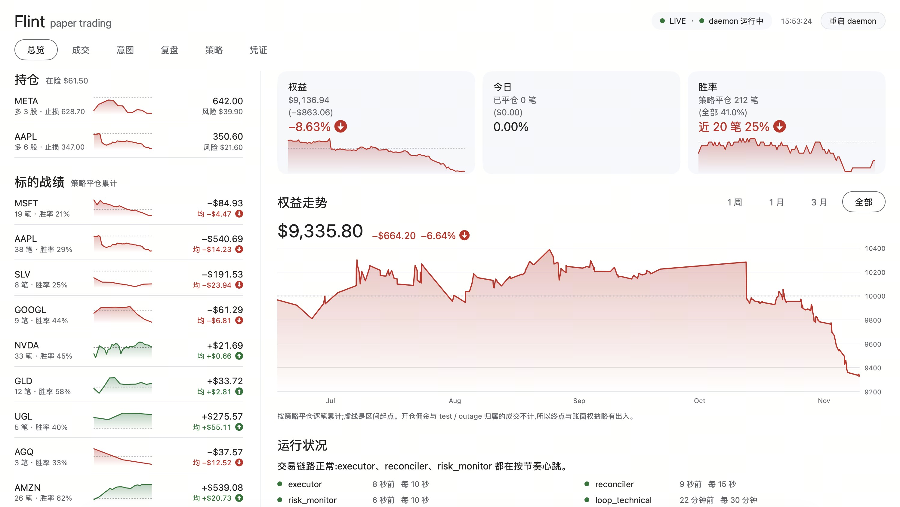

*[中文](README.zh-CN.md)*

# flintrade

An autonomous paper-trading agent that dreams, remembers, and reviews its own trades.

## What it is

flintrade is a single-process, multi-loop daemon that paper-trades US equities. It is written in Go and ships as two binaries: `flintrade-daemon` (the daemon) and `flintrade` (the operator CLI). Internally the daemon runs **eight concurrent loops, one goroutine each**: three signal producers (technical/Arena, event/catalyst, news) write trade *intents* into a SQLite queue; an **executor** consumes that queue through a hard-coded portfolio risk gate before it ever touches a broker; a **reconciler** keeps the book honest against real fills; a **risk monitor** watches for drawdown and can halt trading; a **dreaming** loop synthesizes memory during market-closed windows; and an **invariants** loop audits the ledger read-only.

The core philosophy, carried over from the project's original ["Arena"](docs/agent-architecture.md) design and never relaxed: **the LLM proposes, deterministic code disposes.** The model reasons about direction, sizing rationale, and thesis. It never calls the broker and never writes the books — only the executor places orders, and only after every proposal clears a risk gate that is plain Go code, not a prompt.

## Desktop app




Flintrade.app is the desktop client for the daemon: a native macOS menu bar app and window, built with [MyGo](https://github.com/egoist/mygo) (native UI, no web view). The menu bar shows today's PnL and notifies you when the daemon stops, trading halts or the broker token is about to expire. The window shows equity, positions, per-symbol records, trades, intents, lessons and per-trade reviews. It edits `trading.toml`, `strategies.toml` and the prompts (validated strictly before saving; `risk.toml` stays read-only), and replaces the Longbridge credentials after verifying them with one read-only broker call. It reads the database read-only and never places orders; quitting it does not stop trading.

```bash
(cd cmd/flintrade-app && go tool mygo build -skip-dmg) && cp -R build/darwin-arm64/Flintrade.app /Applications/
```

## Architecture

```
 signal producers (async, each with its own LLM)         single authority (serial)         sleep window
┌───────────────────────────────┐
│ loop_technical   (Arena)       │──intent──┐
│ loop_event       (catalyst)    │──intent──┤     ┌──────────────┐      ┌───────────┐
│ news_collector   (news)        │──signal──┤────▶│   Executor    │      │  reflect  │
│ bin/flintrade        (manual)      │──intent──┘     │ risk gate +   │─────▶│ dreaming  │
└───────────────────────────────┘                │ order + write │      │ (flash    │
                                                  └──────┬────────┘      │  tier LLM)│
       ┌──────────────┐   broker fills (after-hours/     │ only caller   └───────────┘
       │ risk_monitor │◀── partial/stop/etc.)            │ of `longbridge`
       │ circuit       │                                 ▼
       │ breaker       │                          ┌──────────────┐
       └──────┬────────┘                          │  flintrade.db    │  single source
              │ FLATTEN intent      ┌───────────┐  │ (SQLite/WAL) │  of truth
              └────────────────────▶│reconciler │─▶└──────┬───────┘
                                    └───────────┘         │ read-only
                                                    ┌─────┴──────┐
                                                    │ invariants │ ledger audit
                                                    └────────────┘
       supervisor: launchd KeepAlive + in-process watchdog (stale loop / fd pressure → exit 70 → restart)
```

One rule underlies everything: **producers only ever write to the `intents` table; only the executor and the reconciler write `positions`, `trades`, and `orders`, and only the executor calls `longbridge buy/sell`.** Every proposal, whether it comes from a technical signal, a news event, or you typing a command, queues through the same risk gate.

## Why it's interesting

**Arena invariant & single-writer.** `internal/db` is a role-guarded access layer over a WAL-mode SQLite database (schema embedded in the binary) — every handle is opened with a role (`technical`, `executor`, `reflect`, `reader`, ...) and the layer returns an error if that role attempts a write it isn't permitted. Only the executor and reconciler roles can write positions/trades/orders. The `intents` table is the message bus between producers and the executor; nothing talks to anything else directly.

**Portfolio risk gate.** `internal/riskgate` (config in `agent/config/risk.toml`) evaluates every intent through a fixed pipeline before anything is sized: halt check, dedup, no-revenge cooldown, session/volume filters, then risk-based position sizing (`max_risk_pct × equity / stop distance` — not a confidence-scaled guess), correlation-cluster exposure caps (mega-tech / gold / silver / oil buckets so four correlated names don't masquerade as diversification), in-flight order exposure counting (working orders count against limits before they fill), and a circuit breaker that halts all new entries on a daily drawdown threshold. None of this is LLM-mediated — it's plain, hot-reloadable config and code.

**Dreaming memory.** `internal/reflect` runs during closed-market windows. It maintains a bounded set of at most 20 lessons (atomic rewrite each cycle, confidence decay over time, archived below a floor) and dated plans that expire on their own. Recall is time-anchored — the agent knows how long it's been since its last dream or last trade before it reasons about anything. Each technical decision also gets a `similar_history` block (`internal/memory`): a deterministic SQL read of the agent's own closed trades on the same symbol — overall record, record in the current session, and the latest closes. An earlier embedding-based recall was removed after measurement showed it mostly retrieved that same-symbol history anyway.

**Self-postmortem & calibration.** `internal/postmortem` reviews every closed strategy trade with a structured, flash-tier-model verdict: was the thesis right, how were entry/exit timing, how much did it slip against the stop. Hard honesty rules are enforced in the synthesis prompt — a statistic with n<10 can never be phrased as a rule, only as preliminary. The agent's actual track record (sample size, win rate, net P&L) is computed in plain code and injected into every decision as `self_assessment`, so the model can't quietly forget how it's really doing.

**Pluggable LLM tiers.** `internal/llm` is a declarative provider registry over three wire protocols (CLI subprocess, OpenAI chat/completions, Anthropic Messages API) — Claude, OpenAI, DeepSeek, Kimi, OpenRouter, local Ollama, or any OpenAI-compatible endpoint, all selected per tier in `agent/config/trading.toml` with keys read from the environment only. A trader tier (frontier model, the real edge) is separated from a flash tier (cheap model for dreaming and postmortems). Failures retry with backoff but never fall back to a different model — a trading system shouldn't swap brains mid-flight. Every real model call is logged verbatim to `llm_calls/YYYYMMDD.jsonl`, so any trade can be reconstructed from exactly what the model saw.

## Quickstart — one command

```bash
git clone https://github.com/UncertaintyDeterminesYou4ndMe/flintrade && cd flintrade && bash scripts/bootstrap.sh
```

That's it. On a Mac with Go ≥ 1.27 (`brew install go`), `bootstrap.sh` installs the `longbridge` CLI via Homebrew, builds `bin/flintrade` and `bin/flintrade-daemon`, puts a credentials template outside the repo (`~/Library/Application Support/Flintrade/credentials.env`, mode 0600), runs a full dry-run smoke test (all eight loops once against a throwaway database, zero orders, zero LLM cost), and finishes with the read-only self-check `bin/flintrade check`. It's idempotent and ends by printing exactly what to do next — get free [paper-trading credentials](https://open.longbridge.com), pick an LLM, watch a dry run, then flip `FLINTRADE_DRY_RUN=0`.

**Using an AI coding agent?** Paste this into Claude Code / any coding agent:

> Clone https://github.com/UncertaintyDeterminesYou4ndMe/flintrade, run `bash scripts/bootstrap.sh`, then follow AGENTS.md.

`AGENTS.md` gives an agent the full replication contract: setup, verification commands, config knobs, and the safety invariants it must not violate.

### Choosing your LLM

No hard dependency on any one vendor. The default is the local `claude` CLI (no API key needed if you have Claude Code); otherwise pick any provider in `agent/config/trading.toml [models]`:

| provider | wire | key env |
|---|---|---|
| `claude-cli` (default) | Claude Code CLI — rides your Claude subscription | — |
| `kimi-cli` | kimi CLI — rides your Kimi Code plan (`kimi login`) | — |
| `kimi-plan` | Kimi Code plan key, direct API (Anthropic-compatible) — works with a key someone shares with you, no subscription or CLI needed | `KIMI_PLAN_API_KEY` |
| `anthropic` | Anthropic Messages API | `ANTHROPIC_API_KEY` |
| `openai` / `deepseek` / `moonshot` (Kimi open platform, pay-per-token) / `openrouter` | OpenAI chat/completions | `OPENAI_API_KEY` / `DEEPSEEK_API_KEY` / … |
| `ollama` | local, no key | — |
| `openai_compatible` | any compatible endpoint (`base_url` in config) | `LLM_API_KEY` or `api_key_env` in config |

Subscription plans (Claude Code, Kimi Code) are wired through their own CLIs in headless mode — the CLI owns auth and plan billing, flintrade just runs it as a subprocess. Note `kimi-cli` (subscription) and `moonshot` (open-platform API key) are different providers on purpose. API keys go in the credentials file next to the broker keys; the daemon loads it on start.

```bash
bin/flintrade check   # verify credentials, config, tier resolution + keys — read-only, no cost
bin/flintrade ping    # one real round-trip per tier (paid)
```

Two tiers: `trader` (decisions — use a frontier model) and `flash` (dreaming/postmortems — use the cheapest thing you trust). Deliberate design choice: **no automatic cross-model fallback** — if the configured model fails after retries, the agent WAITs instead of trading with a different brain.

`FLINTRADE_DRY_RUN=1` is the default posture in `flintrade.env.example` (and an unset `FLINTRADE_DRY_RUN` also means dry run) — the daemon runs its full decision loop and simulates fills without ever calling the broker. Only flip it to `0` once you've watched it run. Values in the credentials file override the shell environment; `bin/flintrade-daemon --dry-run` forces dry run regardless of the file.

For a persistent deployment, see `launchd/com.flintrade.daemon.plist.example` as a template for running the daemon under launchd (macOS) with auto-restart; `launchd/README.md` has the install steps.

Three operational views:

```bash
bin/flintrade                    # CLI status view (loops, risk state, positions, pending intents, recent trades)
python3 dashboard/server.py  # web dashboard at http://localhost:8383 (system python3, no packages)
(cd cmd/flintrade-app && go tool mygo build -skip-dmg) && cp -R build/darwin-arm64/Flintrade.app /Applications/
```

Flintrade.app is described under [Desktop app](#desktop-app).

## Repo map

| Path | What's there |
|---|---|
| `cmd/` | `flintrade-daemon` (all loops, one process), `flintrade` (status, manual intents, halt/resume, check, ping) and `flintrade-app` (the menu bar app) |
| `internal/` | The daemon's packages — producers, executor, risk gate, reconciler, risk monitor, settlement, broker, dreaming/postmortem, memory, indicators, DB layer, LLM access layer, credentials |
| `agent/` | Config (`agent/config/*.toml`) and producer prompts (`agent/prompts/*.md`); the remaining Python files are read-only helpers for the dashboard |
| `scripts/` | `bootstrap.sh`, and `indicators.py` for the backtests (kept bit-identical with `internal/indicators` by a golden test) |
| `backtest/` | Backtest engines, factor experiments, ML gate research (Python, stdlib only) |
| `dashboard/` | Read-only web UI over the trade log and database |
| `docs/` | Architecture notes |
| `launchd/` | macOS launchd deployment template |

The web dashboard and the backtests are still Python; the backtests will be ported to Go, after which `risk.toml` becomes editable in the app. Nothing on the live trading path runs Python.

## Safety & disclaimer

flintrade is paper-trading only by design, and dry-run (`FLINTRADE_DRY_RUN=1`) is the default in the example config — no order reaches a broker unless you deliberately flip that switch, and even then it targets a paper-trading account, not real capital. This is an educational and research project exploring how far a constrained LLM-proposes/code-disposes architecture can go, not a trading product.

**This is not financial advice.** Nothing here is a recommendation to buy, sell, or hold any security. Use it entirely at your own risk.

## License

Apache License 2.0 — see [LICENSE](LICENSE).
