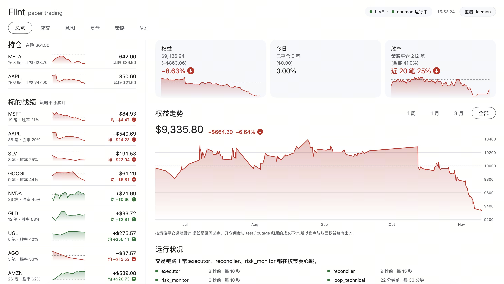

*[English](README.md)*

# flintrade

一个会做梦、会记忆、会复盘自己交易的自治美股模拟交易 Agent。

## 这是什么

flintrade 是一个单进程、多 loop 的常驻 daemon，用来对美股做模拟交易（paper trading）。它用 Go 编写，产出两个二进制：`flintrade-daemon`（daemon 本体）和 `flintrade`（操作用 CLI）。daemon 内部跑着**八个并发 loop，各自是一个 goroutine**：三个信号生产者（技术面/Arena、事件/催化剂、资讯）把交易“意图”（intent）写进一个 SQLite 队列；一个 **executor** 消费这个队列，在触碰 broker 之前必须先过一道硬编码的组合风控 gate；一个 **reconciler** 持续与真实成交对账，保证账本可信；一个 **risk monitor** 监控回撤，必要时可以熔断停手；一个 **做梦（dreaming）** loop 在休市期间把交易历史蒸馏成记忆；还有一个 **invariants** loop 只读地审计账本一致性。

核心理念继承自项目最初的 [“Arena”](docs/agent-architecture.md) 设计，且从未松动：**LLM 只提议，确定性代码来处置。** 模型负责推理方向、仓位背后的理由、交易论点，但它从不直接调用 broker，也从不写账本——只有 executor 能下单，而且只有当每一个提议都通过了一道纯 Go 代码（而非 prompt）实现的风控 gate 之后才行。

## 桌面应用



Flintrade.app 是 daemon 的桌面客户端：macOS 原生菜单栏应用加一个窗口，用 [MyGo](https://github.com/egoist/mygo) 写（原生 UI，没有 WebView）。菜单栏显示当日盈亏；daemon 停了、交易暂停、broker token 快过期时发通知。窗口里看权益、持仓、按标的战绩、成交、意图、教训和逐笔复盘。它能改 `trading.toml`、`strategies.toml` 和 prompt（保存前按严格规则校验，`risk.toml` 只读），也能更换长桥凭据（先用新凭据做一次只读调用验证）。它只读数据库、从不下单；退出 App 不影响交易。

```bash
(cd cmd/flintrade-app && go tool mygo build -skip-dmg) && cp -R build/darwin-arm64/Flintrade.app /Applications/
```

## 架构

```
 信号生产者(异步,各自带自己的 LLM)              单一权威(串行)                 睡眠期
┌───────────────────────────────┐
│ loop_technical   (技术面/Arena) │──intent──┐
│ loop_event       (催化剂/舆情)  │──intent──┤     ┌──────────────┐      ┌───────────┐
│ news_collector   (资讯)        │──signal──┤────▶│   Executor    │      │  reflect  │
│ bin/flintrade        (用户主动)     │──intent──┘     │ 风控gate +    │─────▶│  做梦     │
└───────────────────────────────┘                │ 下单 + 写库    │      │ (flash 档 │
                                                  └──────┬────────┘      │  LLM)     │
       ┌──────────────┐   broker 成交(盘外/                │ 唯一调        └───────────┘
       │ risk_monitor │◀── 部分成交/止损等)                 │ longbridge
       │ 熔断器        │                                    ▼
       └──────┬────────┘                          ┌──────────────┐
              │ FLATTEN intent      ┌───────────┐  │  flintrade.db    │  单一真相
              └────────────────────▶│reconciler │─▶└──────┬───────┘
                                    └───────────┘         │ 只读
                                                    ┌─────┴──────┐
                                                    │ invariants │ 账本审计
                                                    └────────────┘
       supervisor: launchd KeepAlive + 进程内看门狗(loop 停滞 / fd 吃紧 → exit 70 → 重启)
```

贯穿始终的一条规则：**生产者只写 `intents` 表；只有 executor 和 reconciler 写 `positions`、`trades`、`orders`，也只有 executor 调用 `longbridge buy/sell`。** 无论提议来自技术面信号、新闻事件，还是你手动敲的命令，都要过同一道风控 gate。

## 有意思的地方

**Arena 不变量 与 单一写者。** `internal/db` 是一层基于角色守卫（role guard）的访问层，架在 WAL 模式的 SQLite 之上（schema 编译进二进制）——每个句柄以某个角色打开（`technical`、`executor`、`reflect`、`reader` 等），一旦该角色尝试执行它无权做的写操作，这层就返回错误拒绝。只有 executor 和 reconciler 角色能写 positions/trades/orders。`intents` 表是生产者和 executor 之间的消息总线，谁都不直接调谁。

**组合风控 gate。** `internal/riskgate`（配置在 `agent/config/risk.toml`）对每一个 intent 走一条固定流水线：熔断检查、去重、no-revenge 冷却、session/成交量过滤，然后是基于风险的仓位定额（`max_risk_pct × 权益 / 止损距离`，而不是按置信度拍脑袋估的仓位）、相关性簇的敞口上限（mega-tech / 黄金 / 白银 / 原油分桶，防止四个高度相关的仓位伪装成分散配置）、在途挂单敞口的计入（未成交的挂单在结算前就已经算进限额）、以及触发日内回撤阈值就熔断所有新开仓的断路器。这一切都不经过 LLM——是普通的、可热加载的配置和代码。

**做梦式记忆。** `internal/reflect` 在休市窗口运行。它维护一个不超过 20 条的有界 lessons 集合（每轮原子重写、置信度随时间衰减、跌破阈值即归档），以及会自行过期的带日期计划（plans）。唤醒时的回忆是有时间纵深感的——agent 会先弄清楚距上次做梦、上次交易过去了多久，再去推理其他事情。每次技术面决策还会带上一个 `similar_history` 块（`internal/memory`）：用确定性 SQL 读出 agent 自己在同一标的上已平仓的交易——总体战绩、当前时段的战绩、以及最近几笔平仓。早期基于 embedding 的召回已经删除：实测它召回的基本就是这份同标的历史。

**自我复盘与校准。** `internal/postmortem` 用便宜档位（flash tier）的模型，对每一笔已平仓的策略交易做结构化复盘：论点对不对、入场出场时机怎么样、相对止损滑点多少。复盘 prompt 里强制了诚实性硬规则——样本量 n<10 的统计只能表述为初步观察，绝不能变成规则。agent 真实的战绩（样本数、胜率、净盈亏）由纯代码算出，并作为 `self_assessment` 注入每一次决策，模型没法悄悄忘记自己实际做得怎么样。

**可插拔的 LLM 档位。** `internal/llm` 是一张声明式 provider 注册表，底下只有三种协议（CLI 子进程、OpenAI chat/completions、Anthropic Messages API）——Claude、OpenAI、DeepSeek、Kimi、OpenRouter、本地 Ollama 或任意 OpenAI 兼容端，都在 `agent/config/trading.toml` 里按档位选择，key 只从环境变量读。交易档（trader，前沿模型，真正的 edge 所在）和 flash 档（便宜模型，做梦和复盘）分开。失败会退避重试，但绝不静默换模型——交易系统不该在半空中换脑子。每一次真实的模型调用都原样记进 `llm_calls/YYYYMMDD.jsonl`，任何一笔交易都能按模型当时看到的内容复原。

## 快速开始 —— 一条命令

```bash
git clone https://github.com/UncertaintyDeterminesYou4ndMe/flintrade && cd flintrade && bash scripts/bootstrap.sh
```

就这一条。在装有 Go ≥ 1.27（`brew install go`）的 Mac 上，`bootstrap.sh` 会用 Homebrew 装 `longbridge` CLI、编译出 `bin/flintrade` 和 `bin/flintrade-daemon`、在仓库之外放一份凭据模板（`~/Library/Application Support/Flintrade/credentials.env`，权限 0600）、跑一次完整的干跑冒烟测试（八个 loop 各跑一次，用一次性的临时数据库，不下单、不花 token、不需要任何凭据），最后跑只读自检 `bin/flintrade check`。脚本幂等可重跑，结束时会按顺序打印接下来要做的事：申请免费的[模拟盘凭据](https://open.longbridge.com)、选 LLM、观察干跑，最后再把 `FLINTRADE_DRY_RUN` 切成 `0`。

**用 AI 编程助手？** 把这句话粘给 Claude Code / 任意 coding agent：

> 克隆 https://github.com/UncertaintyDeterminesYou4ndMe/flintrade，运行 `bash scripts/bootstrap.sh`，然后按 AGENTS.md 走。

`AGENTS.md` 是给 agent 看的完整复刻契约：安装、验证命令、配置旋钮、以及绝不能违反的安全不变量。

### 选择你的 LLM

不强依赖任何一家。默认走本机 `claude` CLI（有 Claude Code 就零配置）；想换，改 `agent/config/trading.toml [models]` 一行即可：

| provider | 协议 | key 环境变量 |
|---|---|---|
| `claude-cli`（默认） | Claude Code CLI，吃 Claude 订阅 | 免 key |
| `kimi-cli` | kimi CLI，吃 Kimi Code 订阅 plan（`kimi login`） | 免 key |
| `kimi-plan` | Kimi Code plan key 直连（Anthropic 兼容端）——**用别人共享的 plan key 即可跑，不用自己订阅、不用装 CLI** | `KIMI_PLAN_API_KEY` |
| `anthropic` | Anthropic Messages API | `ANTHROPIC_API_KEY` |
| `openai` / `deepseek` / `moonshot`（Kimi 开放平台，按量计费）/ `openrouter` | OpenAI chat/completions | 各家对应 key |
| `ollama` | 本地模型 | 免 key |
| `openai_compatible` | 任意兼容端（配 `base_url`） | `LLM_API_KEY`，或在配置里用 `api_key_env` 自定义 |

订阅制（Claude Code、Kimi Code plan）统一走各家 CLI 的无头模式——鉴权和 plan 计费归 CLI 管，flintrade 只做子进程调用。注意 `kimi-cli`（订阅）和 `moonshot`（开放平台 API key）是刻意分开的两个 provider。API key 和 broker 凭据放在同一个凭据文件里，daemon 启动时自己加载。

```bash
bin/flintrade check   # 只读自检:凭据、配置、各档解析与 key 是否就位,零成本
bin/flintrade ping    # 每档真调一次,验证端到端连通(会花钱)
```

两个档位：`trader`（交易决策，用前沿模型）、`flash`（做梦/复盘，用你信得过的最便宜的）。一个刻意的设计决定：**失败不做跨模型自动 fallback**——配置的模型重试后仍失败，agent 选择 WAIT，而不是换一颗脑子继续交易。

`flintrade.env.example` 里默认就是 `FLINTRADE_DRY_RUN=1`（不设 `FLINTRADE_DRY_RUN` 同样是干跑）——daemon 会跑完整的决策流程并在内部模拟成交，从不真正调用 broker。只有在你看它跑过、确认没问题之后，才把它切成 `0`。凭据文件里的值会覆盖 shell 环境变量；`bin/flintrade-daemon --dry-run` 则无视文件、强制干跑。

如果要长期部署，可参考 `launchd/com.flintrade.daemon.plist.example` 作为模板，在 launchd（macOS）下运行 daemon 并自动重启；安装步骤见 `launchd/README.md`。

三个操作性视图：

```bash
bin/flintrade                    # 命令行状态视图(loop、风控状态、持仓、待裁决 intent、近期成交)
python3 dashboard/server.py  # web 仪表盘, http://localhost:8383(系统 python3,无需装包)
(cd cmd/flintrade-app && go tool mygo build -skip-dmg) && cp -R build/darwin-arm64/Flintrade.app /Applications/
```

Flintrade.app 的介绍见[桌面应用](#桌面应用)。

## 仓库导览

| 路径 | 内容 |
|---|---|
| `cmd/` | `flintrade-daemon`（全部 loop，一个进程）、`flintrade`（状态、手动 intent、halt/resume、check、ping）和 `flintrade-app`（菜单栏 App） |
| `internal/` | daemon 的各个包——生产者、executor、风控 gate、reconciler、risk monitor、结算、broker、做梦/复盘、记忆、指标、DB 层、LLM 访问层、凭据 |
| `agent/` | 配置（`agent/config/*.toml`）与生产者 prompt（`agent/prompts/*.md`）；剩下的 Python 文件只是 dashboard 用的只读辅助 |
| `scripts/` | `bootstrap.sh`，以及回测用的 `indicators.py`（由 golden 测试保证与 `internal/indicators` 逐位一致） |
| `backtest/` | 回测引擎、因子实验、ML gate 研究（Python，只用标准库） |
| `dashboard/` | 只读的交易日志与数据库 web UI |
| `docs/` | 架构文档 |
| `launchd/` | macOS launchd 部署模板 |

web dashboard 和回测暂时还是 Python；回测会迁到 Go，之后 App 里才开放改 `risk.toml`。实盘交易路径上没有任何 Python。

## 安全与免责声明

flintrade 从设计上就只做模拟交易（paper trading），示例配置里干跑（`FLINTRADE_DRY_RUN=1`）是默认值——除非你主动把开关切换过去，否则没有任何订单会到达 broker；即便切换之后，对接的也是模拟盘账户，而不是真实资金。这是一个教育与研究性质的项目，探索“LLM 只提议、代码来处置”这种受约束架构能走多远，而不是一个交易产品。

**这不构成任何投资建议。** 本项目中的任何内容都不是买入、卖出或持有某项证券的建议。使用本项目产生的一切后果由使用者自行承担。

## 许可证

Apache License 2.0 —— 详见 [LICENSE](LICENSE)。
